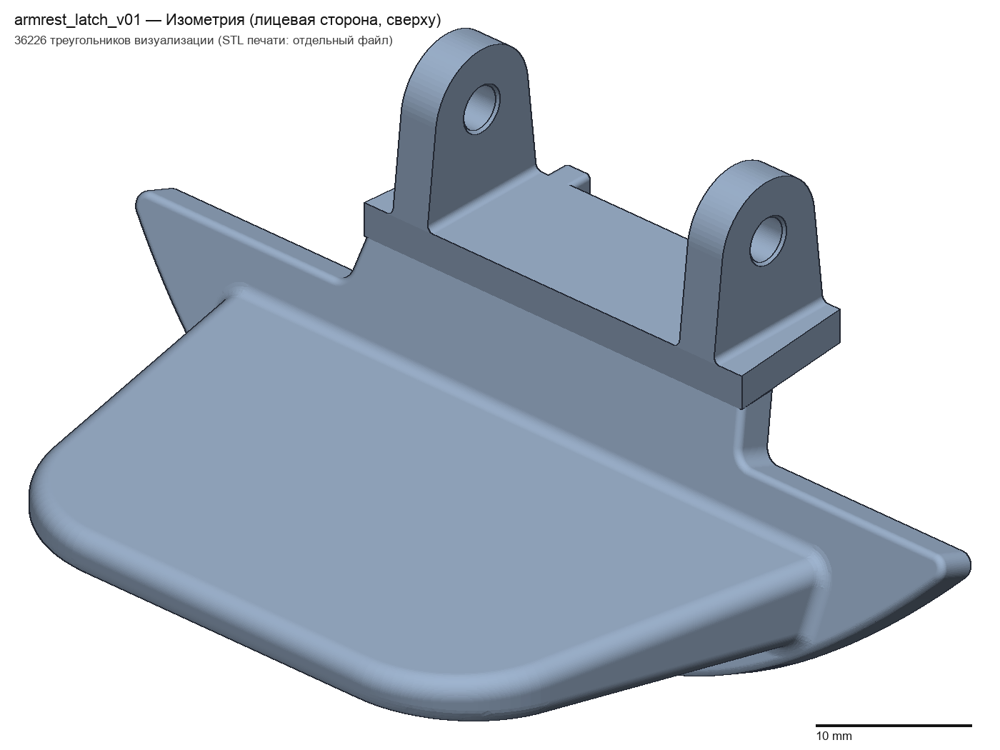
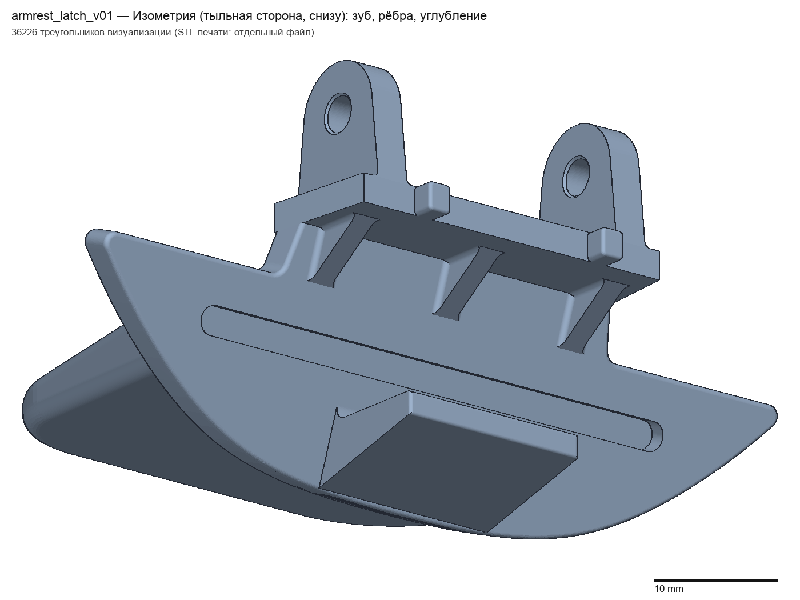
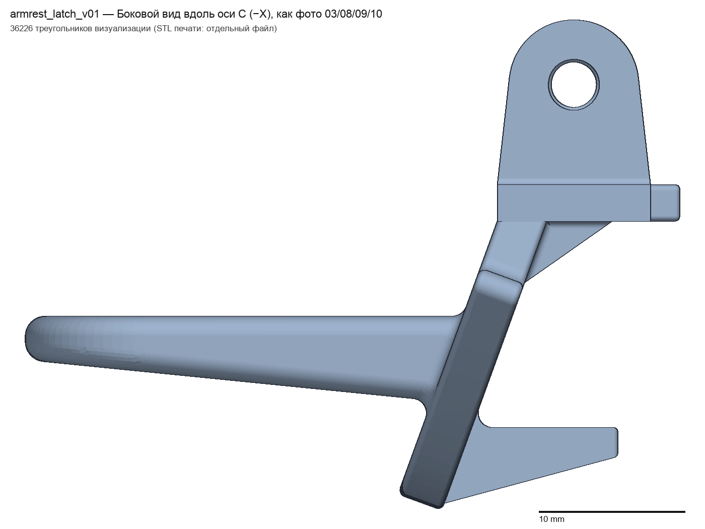
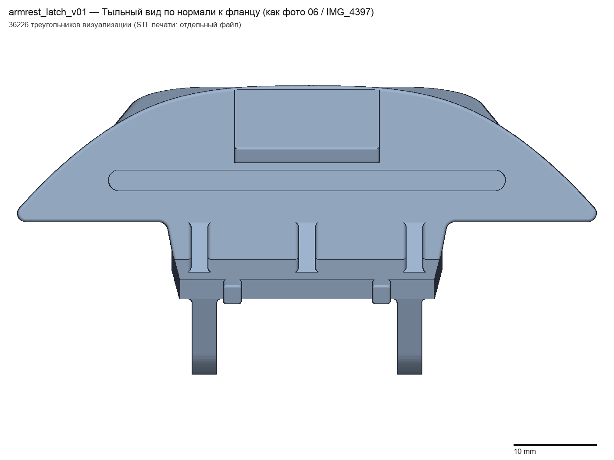

# Armrest latch reconstruction

A parametric **build123d** reconstruction of an automotive armrest lid latch, including its damaged tooth. The repository contains a preliminary model for a physical fit test, CAD source, reference material, and validation reports.

> **Prototype only:** the tooth's retaining face and its engagement with the mating part have not been measured. Fit, retention, strength, fatigue resistance, and performance at automotive temperatures have not been verified.

## Model previews

| Isometric view | Rear isometric view |
| --- | --- |
|  |  |

| Side view | Rear view |
| --- | --- |
|  |  |

Additional views and a dimensioned drawing are available in [`output/`](output/).

## Files

- [`output/armrest_latch_v03.step`](output/armrest_latch_v03.step) — editable solid model, in millimetres.
- [`output/armrest_latch_v03.stl`](output/armrest_latch_v03.stl) — mesh for a slicer; STL does not store units, so use millimetres.
- [`src/params.py`](src/params.py) — parameters and their provenance; [`src/model.py`](src/model.py) — model construction and export; [`src/validate.py`](src/validate.py) — validation checks.
- [`reports/`](reports/) — validation, assumptions, parameters, printing handoff, and environment reports.
- [`input/cad-latch-spec.md`](input/cad-latch-spec.md) — original Russian specification; [`input/cad-photo-atlas.pdf`](input/cad-photo-atlas.pdf) — supplied English photo atlas and specification. The photos are embedded in the PDF; separate original JPEG files are not included.
- [`AGENTS.md`](AGENTS.md), [`START_AGENT.md`](START_AGENT.md), [`ENGINEERING_RULES.md`](ENGINEERING_RULES.md), and [`ACCEPTANCE_CHECKLIST.md`](ACCEPTANCE_CHECKLIST.md) — project instructions and acceptance criteria.
- [`WINDOWS_SETUP.md`](WINDOWS_SETUP.md) — Windows setup; [`INPUT_SHA256.md`](INPUT_SHA256.md) — original input checksums.

The V03 STL is byte-for-byte the V01 STL renamed in commit `430e2d8`; the other model exports and previews have likewise been renamed to V03. This is a file naming change, not a new geometry revision. Older validation reports describe the original V01 build.

## Rebuild

Install the dependencies in [`requirements.txt`](requirements.txt) in a compatible Python environment, then run:

```powershell
.\.venv\Scripts\python.exe src\run_all.py
```

On Unix-like systems, use `.venv/bin/python src/run_all.py`. The pipeline builds the model, validates it, and generates views, a drawing, and photo comparisons. It writes generated files under `output/` and `reports/`.

The 13 November 2026 revision uses **3.1 mm lug holes**, based on the owner's corrected measurement; the earlier 2.5 mm measurement was incorrect. The model remains a preliminary fit-test prototype, and the tooth's retaining geometry needs further measurements.

## References

- [build123d repository](https://github.com/gumyr/build123d)
- [build123d documentation](https://build123d.readthedocs.io/en/latest/)
- [Installation instructions](https://build123d.readthedocs.io/en/latest/installation.html)
